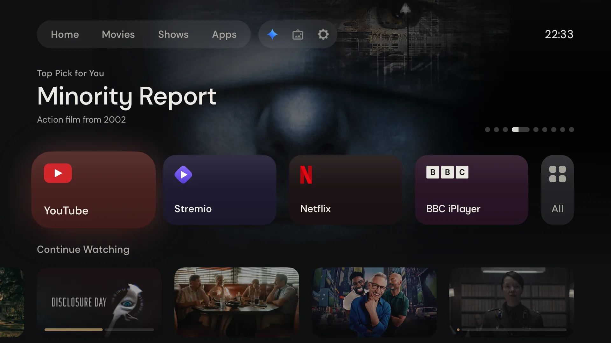
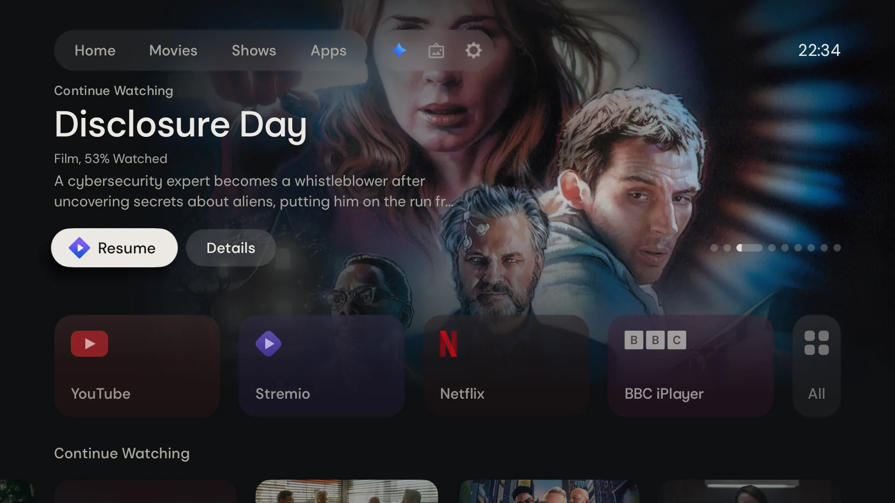
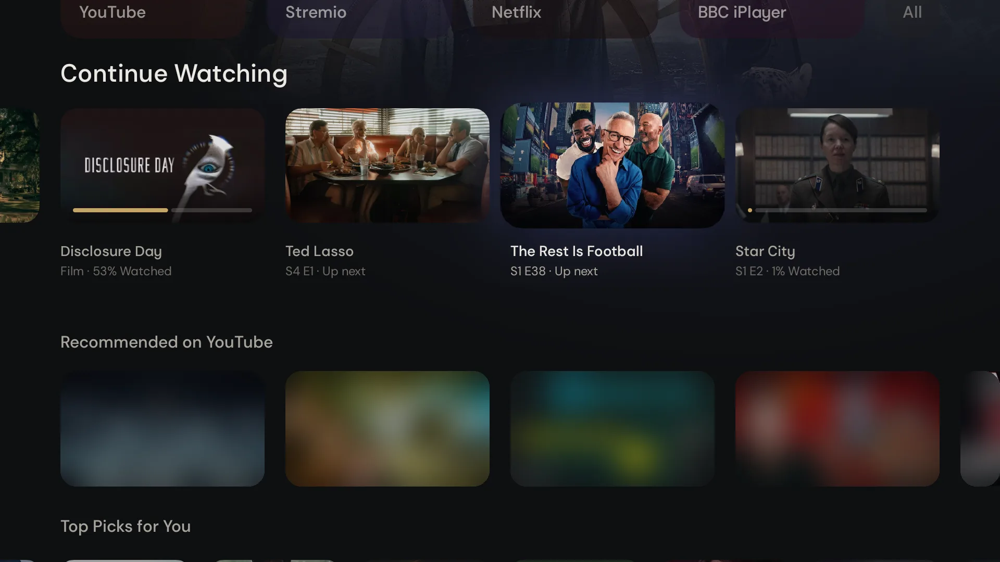
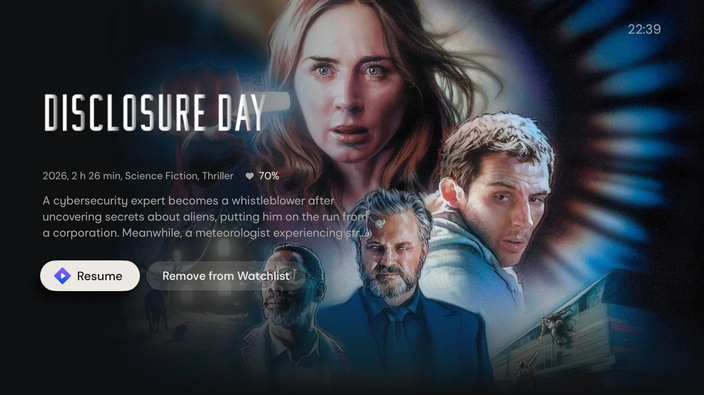
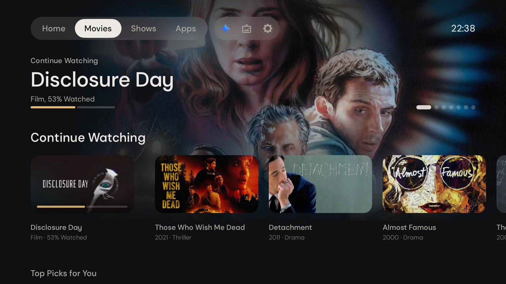
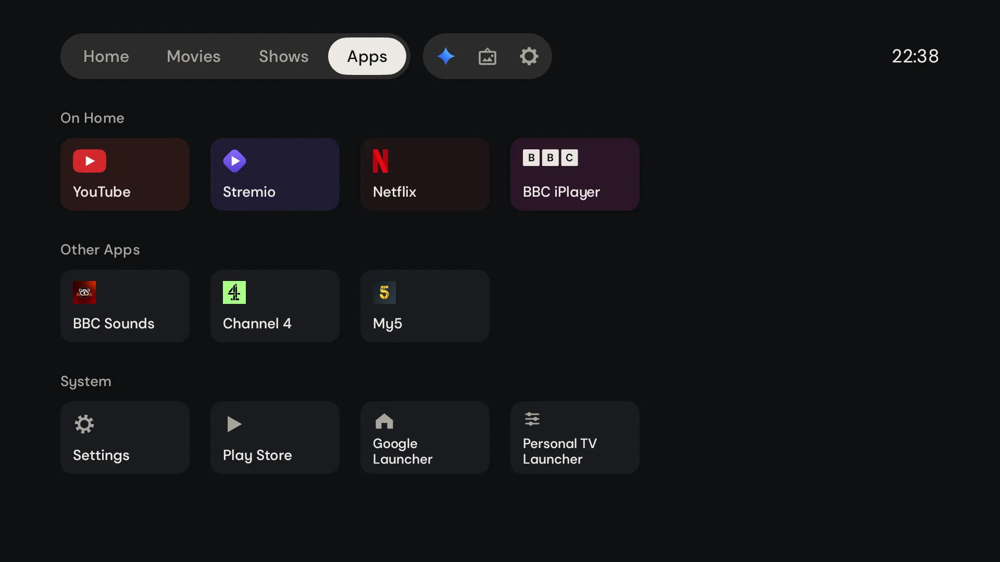

# Open TV Launcher

A home screen for Android TV and Google TV, built on your Trakt lists and Stremio. It runs on the TV, with no server.



<table>
  <tr>
    <td width="50%"><br>Banner, with Resume and Details</td>
    <td width="50%"><br>Continue Watching and YouTube (blurred here)</td>
  </tr>
  <tr>
    <td width="50%"><br>Details</td>
    <td width="50%"><br>Movies tab</td>
  </tr>
  <tr>
    <td width="50%"><br>All Apps</td>
    <td width="50%"><br>Screensaver</td>
  </tr>
</table>

## Requirements

> [!IMPORTANT]
> **Minimum:** Stremio installed on the TV, and a Trakt account with your own Trakt API app. Both are free. Without them, the launcher is not useful.
>
> You also need:
>
> - An Android TV or Google TV device with Android 11 or newer.
> - A computer on the same network as the TV.
> - adb, with Wireless debugging or USB debugging turned on in the TV's developer options.

## Give this prompt to your AI

Paste this prompt into an AI coding assistant on your computer, such as Claude Code or Codex. It sets up the launcher with you, step by step, and asks before it changes anything.

```text
Help me install Open TV Launcher on my Android TV or Google TV.
Repository: https://github.com/AndrewBeniston/open-tv-launcher
Read docs/install.md and follow it. Adapt each step to my computer and TV.

- First check that Stremio is on the TV and that I have a Trakt account.
  If either is missing, stop and tell me.
- Ask me before you install anything, and before every change on the TV.
- Before you change a TV setting, back up the settings with
  scripts/tv-settings.sh, and keep the file.
- Never commit or print local.properties or the signing keys.
- Never disable the TV's own launcher or setup apps. On Google TV, never
  disable com.google.android.apps.tv.launcherx or
  com.google.android.tungsten.setupwraith.
- Offer the screensaver and the Home override one at a time, with undo.
- At the end, tell me what you did and how to undo it.
```

## Manual install and more

- [Install by hand](docs/install.md): every step, how to undo it, and the limits.
- [The Home override](docs/home-override.md): what it does, how to turn it on and off.
- [Features](docs/features.md): the rows, the menus, Settings, All Apps and the screensaver.
- [Troubleshooting](docs/troubleshooting.md)
- [Development](docs/development.md): tests and versions.

## Licence

MIT. See [LICENSE](LICENSE). The Autospawn Sans fonts are under the SIL Open Font License, in `app/src/main/assets/fonts/OFL.txt`. App names and marks belong to their owners.
